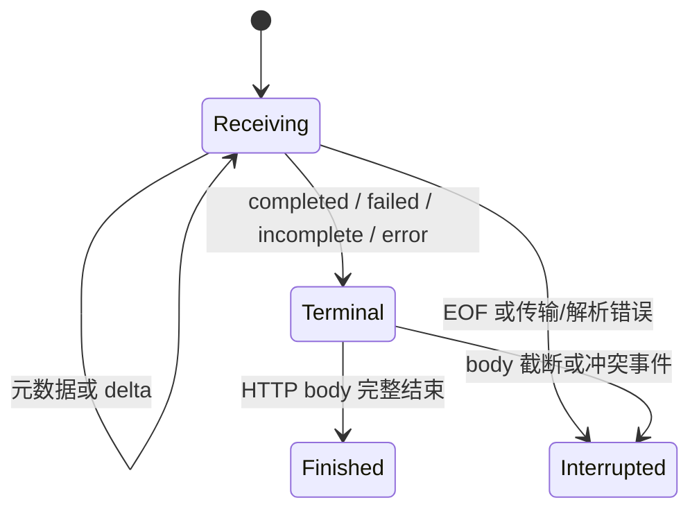

# OpenAI Responses API 强制无状态接入设计

状态：已按本方案实现。验证范围和环境限制见 [实现与验证记录](openai-responses-implementation.md)。

设计日期：2026-09-23。范围包含仓库自有 `native/ai-server/`、管理端、数据库迁移、演示 Provider 和验证。
不修改 Fiber pin、不引入 upstream `apps/ai-server`，不访问或修改研究目录 `.temp/`。

## 1. 目标与范围

新增 `POST /v1/responses`，支持普通 JSON 响应及 `stream=true` 的 HTTP SSE。
Responses 是独立的第三种入站协议，只转发给显式配置 `openai-responses` 的 Provider。
复用 BT1 鉴权、模型授权、路由、连接池、限流、重试框架及审计投递生命周期。

所有 Responses 请求强制执行同一规则：

1. 发往 Provider 的请求始终包含且仅包含一个 `store:false` 和一个 `background:false`。
2. 删除顶层所有 `previous_response_id`、`conversation`，不读取历史、不建立会话缓存。
3. 多轮上下文由客户端在每次 `input` 中完整携带，包括需要重放的工具调用、结果和 reasoning items。
4. 不允许 `input` 中仅靠 `item_reference` 获取已保存的历史内容。
5. 普通响应及 SSE 维持 Responses wire format，不转换成 Chat Completions 或 Anthropic。

首版不提供 Responses 检索、删除、取消、input-items 查询、后台任务轮询、断线续传、
Conversations API、WebSocket 模式、`/v1/responses/compact` 或 token-count 专用端点。
客户端仍可将已有完整 compaction/reasoning item 放入 `input`，其可接受性由 Provider 判断。

这里的“无状态”特指不使用 Responses/Conversations 保存的会话和后台响应状态。
它不等于关闭 prompt cache、实施零数据留存，或把 Provider 的文件、向量库、容器变成无状态资源。
Provider 内置工具和外部资源参数可以透传，但网关不管理这些资源，也不保证它们跨 Provider、
API token 或组织兼容。新功能的基础验收覆盖自包含输入及客户端执行的 function/custom tools；
具体内置工具的可用性需按 Provider 另行验证。

## 2. 实施前的源码基线

以下保留设计写作时的源码基线及待补能力，便于追溯实现范围；当前实现与验证见实现记录。

| 当前位置                                                  | 已有能力                                                           | 本次差距                                               |
| --------------------------------------------------------- | ------------------------------------------------------------------ | ------------------------------------------------------ |
| `native/ai-server/src/AiServer.cpp`                       | Chat Completions、Anthropic Messages 路由                          | 新入口与方法处理                                       |
| `protocol/LlmBody.h`、`LlmBodyExtractor.cpp`              | 两种 wire protocol；抽取 model/stream/messages/tools；记录替换区间 | Responses input/instructions、状态字段、item_reference |
| `protocol/LlmBodyModifier.cpp`                            | 每次 attempt 从原始 IoBuf 替换 model/stream                        | 强制插入字段、删除根成员、重复字段处理                 |
| `config/LlmConfigSnapshot.h`、`LlmConfigCodec.cpp`        | Provider 协议声明与解析                                            | `openai-responses`                                     |
| `provider/ExecutionPlan.cpp`                              | 入站协议匹配 Provider 协议                                         | 第三种精确匹配                                         |
| `protocol/TokenUsage.cpp`                                 | Chat/Anthropic usage、首 token 观察                                | Responses usage 路径与语义事件                         |
| `server/LlmRequestHandler.cpp`                            | 普通转发、SSE relay、审计、check/settle                            | response status、终止事件、协议错误及审计脱敏          |
| `protocol/SseParser.h`                                    | 通用 SSE 分片解析，暴露 data；默认逻辑 data 上限 1 MiB             | 可复用；通过 JSON type 识别 Responses 事件             |
| `observability/AiServerMetrics.*`                         | 两个协议槽位；HTTP 结果分类                                        | 第三槽位和模型结果独立分类                             |
| `server/src/modules/model-marketplace/`                   | 两类协议、能力覆盖、rnacos 渲染                                    | 第三类声明、校验、覆盖及发布                           |
| `server/src/database/migrations/002-model-marketplace.ts` | 协议 CHECK 与两列覆盖投影                                          | 扩展 CHECK，新增覆盖列                                 |
| `server/src/modules/llm-call-audit/`                      | v6 三分量 usage；protocol 字符串；error_json 参与结果判定          | 新协议及语义失败回归，不要求新 usage schema            |
| `web/src/`                                                | 两类协议编辑、筛选、示例、调用记录                                 | Responses 独立展示                                     |

当前 wire enum 的数值参与 `ProviderRouteKey.cpp` 的路由摘要。
新增枚举只能追加，不能重排已有值，否则会改变现有请求的 Provider 亲和性。
`ProviderProtocolType` 中已有 `OpenAiEmbedding` 配置枚举，但没有对应的本次入站能力；保留它。

现有 FILE 审计分支会保留正文并编码 request/output；HTTP 审计分支是最小投影。
Responses 接入不能顺势采集新的请求、工具参数或 encrypted reasoning 内容，见第 9 节。

## 3. 外部接口契约

### 3.1 路由和状态接口

| 请求                                                  | 目标行为                                                 |
| ----------------------------------------------------- | -------------------------------------------------------- |
| `POST /v1/responses`                                  | BT1 鉴权、授权、强制无状态、转发                         |
| 其他方法访问 `/v1/responses`                          | 405，`Allow: POST`；HEAD 不输出 body                     |
| `/v1/responses/{id}` 及其子路径                       | 404，OpenAI 风格 `unsupported_endpoint`；不查询 Provider |
| `/v1/responses/compact`、`/v1/responses/input_tokens` | 首版同样返回 `unsupported_endpoint`                      |
| `/v1/conversations` 及子路径                          | 明确不支持，404；不转发                                  |
| Responses WebSocket Upgrade                           | 不建立隧道；按不支持的方法/端点处理                      |

错误只包含固定说明和字段路径，不反射历史 ID、正文、工具参数或凭据。
创建端点沿用当前先 BT1 鉴权再检查方法的顺序；表中的 405 指已通过鉴权的请求，未认证仍返回认证错误。
请求 query 和客户端 Authorization 不追加到 Provider URL/headers；保持现有 typed Provider 客户端构造方式。
Provider 的路径来自配置，`Content-Length`/body plan 根据改写后的 IoBufChain 长度生成。

### 3.2 输入校验与改写

| 字段                                                              | 规则                                                                                 |
| ----------------------------------------------------------------- | ------------------------------------------------------------------------------------ |
| `model`                                                           | 必填非空 string；先按逻辑模型授权，每次 attempt 再替换为上游模型                     |
| `input`                                                           | 首版要求 string 或 array；空值是否能生成由 Provider 决定；缺省/null/其他类型返回 400 |
| `stream`                                                          | 缺省/null 视为 false；boolean 按原值；其他类型返回 400；null 在出站时规范化为 false  |
| `store`、`background`                                             | 缺省、null、boolean 均规范化成 false；其他类型返回 `invalid_request_field`           |
| `previous_response_id`、`conversation`                            | 识别解码后的顶层 key，完整校验 JSON 后删除对应成员；不要求被删除 value 符合上游类型  |
| `instructions`                                                    | string/null/缺省；保留，用于 Responses 亲和性                                        |
| `tools`                                                           | array/null/缺省；保留结构与词法；只统计及哈希，不执行工具                            |
| `prompt_cache_key`                                                | 非空 string 时优先作为亲和性键；null/空值走语义亲和性；其他类型返回 400              |
| `include`                                                         | 原样保留；不强制修改数组或自动增加字段                                               |
| `input[*].type == "item_reference"`                               | 400 `stateful_input_reference_unsupported`，字段路径指向 item；不查询、不静默丢弃    |
| 完整 message/function_call/function_call_output/reasoning 等 item | 保留；不因为带有 id 或 call_id 就删字段                                              |
| 其他字段                                                          | 在既有长度、JSON 语法边界内透传，由 Provider 校验；不递归删除同名字段                |

客户端可以通过 `include:["reasoning.encrypted_content"]` 请求其 Provider 支持的加密推理输出。
网关不解密、不保存、不删改该内容，也不假设所有兼容 Provider 默认返回它。
这不保证加密 item 在不同 Provider、token、组织或模型之间可重放。

仅提供历史 ID 的输入无法无损改写为完整上下文。本设计对顶层引用采用用户要求的强制删除策略：
剩余输入继续执行，不因带有 previous_response_id/conversation 本身而拒绝。
但 item_reference 本身没有可执行内容，因此返回 400 要求客户端改发完整 item。
缺失 `input` 的纯历史引用请求同样返回输入校验错误。

首版不支持仅通过持久化 prompt template 省略 `input` 的请求；这属于上述自包含输入契约，
不能把它宣传为完整的 Responses API 全部参数组合兼容。

### 3.3 重复字段与类型绕过

Responses 使用独立校验策略，不改变 Chat/Anthropic 已有 last-wins 行为：

- `store`、`background` 的每次出现均检查类型，删除全部原成员，最后写入唯一 false。
- `previous_response_id`、`conversation` 的每次出现全部删除。
- 对会影响网关解释的 `model`、`stream`、`input`、`instructions`、`tools`、`prompt_cache_key`
  重复出现返回 `duplicate_request_field`；避免客户端、网关、Provider 的 first/last-wins 分歧。
- `input` 的直接 item 对象中，重复的判别字段 `type` 返回 400；任一次为 item_reference 也不能放过。
- 比较 JSON parser 解码后的 key/value，`"st\u006fre"` 与 `"store"` 是同一字段。
- 工具 schema、metadata、普通文本内的同名属性不受该策略影响。

普通错误使用 OpenAI envelope：

```json
{
  "error": {
    "message": "Send the complete input item instead of a stored item reference.",
    "type": "invalid_request_error",
    "param": "input[0]",
    "code": "stateful_input_reference_unsupported"
  }
}
```

示例只使用合成值。客户端实际正文不得进入代码、日志或发布证据。

### 3.4 客户端行为变化

- `background:true` 变成当前 HTTP 请求中的执行；`stream:true` 仍然流式返回，不等待完整结果再发送。
- 客户端不能依赖 queued 状态、轮询、取消端点或流续传。长任务应使用 SSE 并配置相应超时。
- Provider 返回的 `response.id` 保留，供客户端识别本次结果；不代表网关支持以后按 ID 读取。
- 下一轮应提交原始历史 input、上一轮完整 output，以及新消息/工具结果。
- 不创建 response ID 到 Provider/token 的绑定表，不新增会话 MySQL/Redis 表，不使用粘性实例保存历史。

## 4. Native 模块与 API 设计

### 4.1 协议类型与统一分派

增加聚焦的 `protocol/LlmWireProtocol.h`，将 wire enum 从 `LlmBody.h` 移出并由其显式包含。
保留已有数值，追加 `OpenAiResponses` 和 `Count`。
提供无分配的 `constexpr` helper：

```cpp
enum class LlmWireProtocol : std::uint8_t {
    OpenAiChatCompletions = 0,
    AnthropicMessages = 1,
    OpenAiResponses = 2,
    Count,
};

constexpr bool uses_openai_error_envelope(LlmWireProtocol protocol) noexcept;
constexpr std::string_view llm_protocol_name(LlmWireProtocol protocol) noexcept;
constexpr std::size_t llm_protocol_index(LlmWireProtocol protocol) noexcept;
```

名称保持旧值 `openai`、`anthropic`，新增 `openai-responses`。
采用 exhaustive switch；有效协议在边界建立不变量，Count 不能进入运行路径。
错误 envelope 可以共用 OpenAI family 判断，usage、请求结构和 SSE 错误必须按具体协议分派。
逐处消除“不是 Chat 就是 Anthropic”的隐含分支，不以统一布尔判断替换所有协议行为。

`ProviderProtocolType::OpenAiResponses` 追加到已有配置 enum；codec 接受 `openai-responses`。
`ExecutionPlan` 建立明确映射，不回退到 Chat/Anthropic。无候选沿用现有无可用 Provider 错误语义。
配置快照的 find_protocol、重复协议校验、模型可执行性校验同步覆盖新枚举。

### 4.2 ParsedLlmBody 所有权与解析结果

保留 `ParsedLlmBody::parse(protocol, IoBuf, BufPool&)` 和按 attempt 调用 `rewrite(...)` 的方式。
在对象中保存 protocol 及 Responses 专用解析结果；策略由入站协议决定，调用者不能关闭。

新增小型 `ResponsesBodyPolicyInfo`，只包含固定标志：

```cpp
struct ResponsesBodyPolicyInfo {
    bool store_was_true = false;
    bool background_was_true = false;
    bool previous_response_removed = false;
    bool conversation_removed = false;
};
```

标志只用于固定标签计数，不保存被删除的 ID/value，不把原始请求传给审计。
`LlmRoutingData` 继续保存 model、stream、亲和性摘要、计数；Responses 的 message_count
统计 input 中的 message/easy-message，字符串 input 计 1，工具结果及 reasoning item 不冒充 message。
如未来需要 item_count，再独立演进审计 schema，本次不改变旧字段含义。

解析器同一次扫描完成：完整 JSON 校验、必要字段抽取、item_reference 检查、亲和性摘要、改写布局。
所有 view 的生存期由原始 IoBuf 或请求 BufPool 保证；不把 parser 临时解码 view 留到 parser 销毁以后。
对非 item_reference 的新 item type 不做完整业务 DTO 解析，保留前向兼容性。

`LlmBodyErrorCode` 增加重复字段、状态引用、字段数上限三类错误，已有 InvalidFieldType 保留。
handler 不再把 Responses 的所有 parse/rewrite 错误统一压成 invalid_json：语法错误映射 400 invalid_json，
类型错误映射 400 invalid_request_field，新增三类映射本章规定的 code，OutOfMemory 映射 500 internal_error。
field 使用固定路径或在请求 BufPool 编码的有界索引路径，不引用被释放的 parser 内存，不包含字段值。

### 4.3 根成员切片改写

Responses 的根成员删除不复用“只替换 value”补丁去猜测逗号位置。
增加 Responses 专用根成员布局，每个记录包含 key 起点、完整 value 结束位置、必要的 value 起点和动作。
记录位于请求 BufPool，使用现有 RequestArrayBuilder 模式，禁止 vector/DOM/通用 std::function。

算法：

1. 一次扫描记录根成员跨度，起点是 key 的开引号，终点是 value 的排他结束位置；容器追踪到匹配闭合。
2. 出站写入 `{`，按原顺序选择保留成员，成员之间由 writer 输出一个逗号。
3. 普通成员用 retain_slice 保留 key、冒号和完整 value；model 使用原 key/冒号片段加编码后的模型名。
4. stream 的 null 规范化为 false；boolean 原值或已有显式 override 由统一逻辑输出。
5. 跳过全部 store/background/previous_response_id/conversation 成员。
6. 追加固定的 `"store":false,"background":false`，写入 `}` 并 mark_complete。

允许重建根层空白和逗号，不承诺整个根对象字节级不变；保留成员内部及未知 value 的词法字节不变。
现有两种协议继续使用原来的 value-patch 快路径及词法保持契约。
原始 IoBuf 不被修改，每次重试独立生成切片链；不能对上一 attempt 的输出再改写。

成员记录内存为 O(根成员数)，扫描为 O(正文大小)，重试为 O(根成员数 + replacement 大小)。
设置 Responses 根成员上限 4096，超限返回 400 `too_many_request_fields`；记录数组及增长分配均受此上限约束。
保留现有 4 MiB 入站限制；Responses Provider 上游模型名在 native 配置解析时限制为 512 UTF-8 字节，
与管理端当前上游模型名限制一致，仅对新增协议建立这一约束，不改变旧协议配置接受范围。
出站长度上限为 4 MiB + 4 KiB，覆盖单个模型名最坏 JSON 编码增量及固定策略字段；
长度运算检查溢出，超出上限按内部改写错误终止，禁止无界增长。
静态标点和固定策略片段复用同一小型 owned IoBuf；slice 不引用临时栈内存。
分配失败返回服务器内部错误，不把 OOM 误报成客户端 invalid_json。

### 4.4 Responses 路由亲和性

优先级为：非空 prompt_cache_key → Responses 语义摘要 → principal/model fallback。
新增 `ResponsesSemanticAnchor` 到 `PromptRouteKeySource` 的现有有效值之后，保留旧值。
prompt_cache_key 可复用既有 OpenAiPromptCacheKey 来源；wire protocol 已在外层 hash 中隔离。

语义摘要按固定的 component 顺序组合：tools、instructions、input 开头连续的 system/developer messages、
第一个 user message。字符串 input 视作一个 user message。后续 assistant/tool/reasoning items 和新增轮次不参与锚点。
输入不是这种前缀结构时，仅使用已经存在的 tools/instructions 部分；都没有则 fallback，不能扫描寻找任意后续 user 使锚点漂移。
使用当前带 tag/长度的 DigestBuilder；不包含 store/background/历史 ID，不存储 prompt 明文。
输入采用固定 item 顺序，同一语义值的字符串转义不改变摘要；不额外承诺 JSON 对象字段任意重排后 hash 相同。

亲和性是缓存命中优化，不是历史状态恢复机制。重试、fallback、配置变化仍可能切换 Provider/token。
依赖 Provider 专有 opaque item 或外部资源的客户端应选择配置上兼容的候选集合，不能依赖这层摘要实现硬绑定。

## 5. Responses 响应观察器

新增 `protocol/ResponsesObservation.h/.cpp`，负责从 JSON/SSE data 提取固定元信息。
复用 Fiber 的静态 JsonPathProgram/事件 parser，初始化时编译路径；不构造完整 Response DTO。

拟新增结果类型：

```cpp
enum class ResponsesTerminal : std::uint8_t {
    None,
    Completed,
    Failed,
    Incomplete,
    Error,
};

struct ResponsesObservation {
    std::optional<LlmTokenUsage> usage;
    ResponsesTerminal terminal = ResponsesTerminal::None;
    std::optional<std::int64_t> sequence_number;
    bool output_token_observed = false;
    bool invalid_json_or_shape = false;
    bool state_policy_violation = false;
    // 错误类别采用有限枚举；不保存 Provider 原始 message。
};
```

普通响应与事件分别入口；现有 TokenUsage 接口通过明确 switch 调用 Responses 解析。
relay 在同一事件上只调用一次 Responses observer，再将结果交给 usage、首 token、终止状态及指标。
不为审计重复扫描、拼接输出内容。

### 5.1 普通响应

成功 HTTP 状态下要求 JSON object、`object:"response"` 和可识别的最终 status。
`completed`、`failed`、`incomplete` 均按上游 HTTP 状态和原始 body 返回，模型结果分别记录。
`queued`/`in_progress` 作为非后台普通响应的最终结果不合法；未知/缺失 status、无效 JSON 返回 502
`upstream_invalid_response`，不得记录成功。非 2xx 沿用 Provider HTTP 错误处理与重试规则。

显式回显 `store:true`、`background:true`、非空 previous_response_id/conversation 视为上游违反策略。
未提交下游 headers 时返回 502 `upstream_state_policy_violation`，不靠修改响应字段掩盖。
缺省/null 不推断为违反；这些检查只能发现明显协议偏差，无法证明第三方实际没有保存数据。

### 5.2 Token usage

| 场景                                     | 读取位置                                                                                      |
| ---------------------------------------- | --------------------------------------------------------------------------------------------- |
| 普通最终响应                             | `$.usage.input_tokens`、`$.usage.input_tokens_details.cached_tokens`、`$.usage.output_tokens` |
| completed/failed/incomplete SSE 最终事件 | 对应 `$.response.usage.*`                                                                     |

只从最终 Response 快照接受 usage，忽略 created/in_progress 的空值或预估值。
三个分量按以下规则映射：

```text
in_cache   = cached_tokens
in_nocache = input_tokens - cached_tokens
out        = output_tokens
```

缓存分量缺省时，仅在 input_tokens 合法且 details/cached 字段确实缺省时按既有 OpenAI 兼容约定采用 0；
显式 null、错误类型、负数不伪造为 0。cached > input 时 uncached 未知，并记录有限的 invalid-usage 观察。
缺少某分量保持 null。sum 使用 int64 溢出保护；未知和真实 0 必须不同。
`output_tokens_details.reasoning_tokens` 已包含在 output_tokens 内，不再次相加。
忽略 total_tokens 的累加，不把多个事件的 usage 相加；重复相同终止事件也不能重复计量或结算。

failed/incomplete 有合法 usage 时仍计量。usage 不完整时执行现有 no-usage settle，不将未知用量当成确定 0。

## 6. SSE 状态机与传输生命周期

### 6.1 观察状态和事件

`SseParser` 的业务数据继续使用 data；通过 JSON `type` 分派，原始 SSE 的 event/id/retry/comment 字节仍原样转发。
只扩展仓库自有 wrapper 的边界观察，不修改 Fiber：给 `SseEventView` 增加 `ended_by_delimiter`，
并给 parser 增加 `at_event_boundary()`。现有两个协议不消费这些新信息，保持其 EOF 行为。
合法未知事件透传但不参与计量；无效 JSON/缺少 type 作为协议错误。
Responses 不以 `[DONE]` 结束；出现该非 JSON data 时按协议错误处理。

当前 wrapper 会在 cursor Complete 时发布残留 data，即使没有 EventEnd。
Responses 只接受 `ended_by_delimiter=true` 的终止事件；EOF 刷出的残留 JSON 不能作为合法完成证据。
`at_event_boundary()` 反映真实已消费字节，不因 finish()/reset 清理状态就伪装成完整边界；
CR、LF、CRLF 和跨 chunk 的 CRLF 都必须单独测试。

| 事件                                                                                   | 模型状态   | 计量/首 token                    |
| -------------------------------------------------------------------------------------- | ---------- | -------------------------------- |
| `response.created`、`response.in_progress`                                             | None       | 不记首 token，不使用 usage       |
| 非空 `response.output_text.delta`、`response.refusal.delta`                            | None       | 首 token 候选                    |
| 非空 `response.function_call_arguments.delta`、`response.custom_tool_call_input.delta` | None       | 首 token 候选                    |
| 非空 reasoning text/summary delta                                                      | None       | 首 token 候选；不保存文本        |
| output_item/content_part added/done 等                                                 | None       | 只透传；不把结构元数据算成 token |
| `response.completed`                                                                   | Completed  | 接受一次最终 usage               |
| `response.failed`                                                                      | Failed     | 提取安全错误类别和可用 usage     |
| `response.incomplete`                                                                  | Incomplete | 提取安全原因和可用 usage         |
| `error`                                                                                | Error      | 记录安全错误类别；不是成功完成   |

仅有非文本输出而没有受支持的 token delta 时，time-to-first-token 保持未观察，不用响应头时间代替。
终止事件的 type 与内嵌 response.status 必须匹配。`response.created` 可缺省，不把 Provider 特定的事件数量写死。



首个合法终止结果锁定，之后允许注释/空行及不改变结果的扩展元数据。
重复相同终止事件忽略其 usage；不同终止类型或终止后新输出 delta 记为协议冲突。
不保留所有事件或完整 output 数组，状态为固定大小。

### 6.2 传输完整与模型完成分离

扩展内部 `SseRelayResult`：保留 upstream_error、upstream_complete、downstream_delivery_failed，
另加 Responses terminal、protocol failure、安全失败类别。

- `upstream_complete` 仅表示 HTTP body 被完整读取，不能推出模型成功。
- 有 failed/incomplete/error 终止事件且 EOF 正常：传输完整，模型未成功，保留原事件。
- 无任何终止事件即 EOF：`upstream_missing_terminal_event`，不能算 success。
- 已观察终止事件后 HTTP body 截断：保留已得 usage，但整体交付/传输失败；不再合成第二个终止事件。
- 完整终止事件的 usage 不会因下游断开而被丢弃。

在 HTTP headers 已发送后，不能改为 HTTP 502，也不能切换 Provider 重放。
普通 2xx response.status 为 failed/incomplete 同样不引入新的自动重试；避免隐藏模型结果或重复工具副作用。
已有“发送下游响应前”的网络/HTTP 状态重试继续沿用，不能宣称其对 Provider 内置工具保证 exactly-once。

### 6.3 网关生成的流错误

没有合法终止事件、下游仍可写且 SSE 边界完整时，发送 Responses 格式：

```text
event: error
data: {"type":"error","code":"upstream_stream_error","message":"Upstream response stream ended prematurely.","param":null,"sequence_number":12}

```

sequence_number 使用已观察的最大合法非负序号加 1；尚未观察时使用 0。
不要求序号连续，不修改上游原始序号。溢出、无法编码或下游不可写时 abort，不发送伪造成功或 `[DONE]`。
Provider 显式状态策略违规使用固定 code `upstream_state_policy_violation`。

relay 必须知道最后已发送的字节是否结束于完整 SSE event 边界。
在一个 chunk 解析完且 `write_all` 成功后，将 parser 的边界观察提交为 downstream boundary；
解析失败但尚未发送的 chunk 不推进这个状态，部分写失败直接 abort。
若此前已转发不完整的 data/event，直接 abort，不能在半个 JSON 后拼一个“错误事件”，也不能靠加空行
把无效 data 冒充合法事件。首版不为此缓存整个响应；保留现有流式背压与 chunk 传递。
针对正常 EOF 但缺失终止事件，可在最近完整边界合成 error。

### 6.4 下游断开与 shutdown

保留当前 relay 的排空方式：下游关闭后停止写下游，继续读取 Provider 以获取 usage。
当前 300 秒 read timeout 是单次读取超时，不能当作整个排空阶段的总时限。
Responses 路径额外在首次发现下游关闭时设置 300 秒绝对 drain deadline；后续每次读取的 timeout
取现有 read timeout 与剩余时长的较小值，使用 EventLoop.current().now()，keepalive 不延长 deadline。
达到 deadline 时 abort 上游并用已获得的 usage 或 no-usage 结算；shutdown/cancel 可以提前终止读取。
旧 Chat/Anthropic 路径的 drain 策略不借此修改；新 deadline 的记录只属于本次 Responses request。
断连没有触发新的 Provider attempt；rate-limit ticket 只 settle 一次，析构兜底不能重复结算。
沿用连接 lease、实例 report 和 stop/drain 的所有权顺序，不新增 detached coroutine。

### 6.5 结果对健康状态的影响

| 结果                                              | 请求业务结果                 | Provider 实例/熔断                     |
| ------------------------------------------------- | ---------------------------- | -------------------------------------- |
| completed 且交付完整                              | success                      | 成功                                   |
| incomplete，例如 max_output_tokens/content_filter | incomplete                   | 有效协议响应，不作为连接故障           |
| failed/error，明确 auth/rate-limit code           | failed/error                 | 复用 token 级不可用分类；已开流不重试  |
| failed/error，明确 server_error                   | failed/error                 | 按有限分类记录 Provider 故障           |
| failed/error，未知 code                           | failed/error                 | 中性，不因任意 message 触发 token 封禁 |
| malformed/missing terminal/策略违规               | invalid_response/interrupted | Provider 协议故障                      |
| 单纯下游断连，上游有效完成                        | aborted                      | 不把客户端故障惩罚给 Provider          |

错误分类读取 Response 内嵌 error 和顶层 error event，不能直接套用只看 HTTP status 的分类器。
只用明确 code/type 的 allowlist，原始 message 不成为指标标签或审计错误文本。

## 7. 限流、指标与 CAT

### 7.1 限流

继续使用现有 user + logical model check/settle，Responses 与同一逻辑模型的其他协议共享配额。
不按协议另建额度，不改变分布式 owner 选择。请求校验、状态引用拒绝发生在申请 ticket/访问 Provider 之前。
stream 和 buffered 路径均把有效 usage.sum 交给 RateLimitSession；正常、failed、incomplete、断连、shutdown
都必须覆盖一次且仅一次结算。

### 7.2 指标

所有按协议数组改为 `LlmWireProtocol::Count` 的尺寸，增加 `openai-responses`，保留旧 label 值。
现有 requests 的 HTTP result 分类继续表达传输/HTTP 结果，不把 HTTP 200 改写为伪造的 HTTP 失败。
新增有限标签业务计数：

```text
ai_server_responses_results_total{result="completed|failed|incomplete|error|interrupted|invalid_response|aborted"}
ai_server_responses_policy_rewrites_total{field="store|background|previous_response_id|conversation"}
```

results 每个实际启动过 Provider attempt 的 Responses 请求终结时只增加一次；
优先级为下游 aborted、传输/协议失败、模型终止结果。前置鉴权/校验失败仍由现有请求指标记录。
policy rewrites 在校验成功后按请求计数，store/background 仅在客户端明确 true 时计数，
历史引用只要出现并被移除就计数；缺省补 false 不算“客户端有状态请求”。
重复字段和重试均不能把一次逻辑请求计成多次策略改写。
标签不包含 response ID、conversation ID、prompt_cache_key、任意上游错误 message。

同步 Grafana 协议选择与新结果面板，不将 `incomplete` 归为成功，也不把它当作网络故障。

### 7.3 CAT

CAT 请求与 Provider attempt 使用新协议名、安全终止类别和现有耗时；模型 failed/incomplete 不报 success。
请求正文、完整响应、工具参数、状态引用和 encrypted_content 不写 CAT。
错误 envelope 家族为 OpenAI，但流错误格式使用 Responses 专用实现。

## 8. 管理端、数据库与发布

### 8.1 类型和 API

后端及前端 ProviderProtocolType 追加 `OPENAI_RESPONSES`，序列化配置为 `openai-responses`。
Provider 编辑默认路径 `/v1/responses`，与 Chat 的 `/v1/chat/completions` 分开配置上游 model。

模型能力结构保持现有 key，新增 responses：

```ts
type ModelProtocolCoverage = {
  openai: ProtocolCoverage
  anthropic: ProtocolCoverage
  responses: ProtocolCoverage
}
```

`openai` 仍然只表示 Chat Completions，不重新解释为 OpenAI 全家族。
marketplace 查询 `protocol` enum 增加 `responses`；审计查询值则使用 wire 名 `openai-responses`，
通过明确映射关联，不在各页面各写一份条件表达式。
缺少新 key 的历史 release 快照按 UNSUPPORTED 展示，不能推断有 Chat 就有 Responses。
冻结版本的 Provider protocol 数组是能力计算源；兼容处理只做读取投影，不重写历史 release。

`protocolCoverage()` 对 PRIMARY 或已启用 fallback 中未归档 Provider 精确匹配第三种协议。
仅 Responses 可用的模型不触发 PROTOCOL_COVERAGE_EMPTY。
新增 `RESPONSES_PROTOCOL_UNSUPPORTED` warning，沿用现有缺少某协议的提示级别；不能要求模型同时支持三类协议。
已有 tokenless Provider 契约和 access-group 授权保持不变。

### 8.2 数据库迁移

新增 `009-openai-responses-protocol.ts`，在 `database/migrate.ts` 和迁移测试注册。
编号以实际实施时未占用的下一个编号为准；不修改已发布的 002/008。
需要执行两条各自仅涉及一个业务表的 DDL：

```sql
ALTER TABLE marketplace_provider_protocols
  DROP CHECK chk_provider_protocol_type,
  ADD CONSTRAINT chk_provider_protocol_type CHECK (
    protocol_type IN (
      'OPENAI_CHAT_COMPLETIONS', 'ANTHROPIC_MESSAGES', 'OPENAI_RESPONSES'
    )
  );

ALTER TABLE model_marketplace_projections
  ADD COLUMN responses_coverage VARCHAR(16)
    CHARACTER SET ascii COLLATE ascii_bin NOT NULL DEFAULT 'UNSUPPORTED'
    AFTER anthropic_coverage,
  ADD CONSTRAINT chk_model_projection_responses_coverage
    CHECK (responses_coverage IN ('SUPPORTED', 'UNSUPPORTED', 'INVALID'));
```

历史版本不能包含之前不允许的 Responses 协议，因此初始 UNSUPPORTED 是正确回填，不需要跨表 SQL。
更新所有投影 INSERT/读取/重建路径的列清单和参数；memory/mysql store 对三类能力结果一致。
published 与 draft 投影分别从各自版本计算，不把草稿能力泄漏到发布视图。
覆盖列保留现有 ProtocolCoverage 类型中的 INVALID 值，即使当前正常 coverage 计算主要返回前两种。
运行期仍使用单表参数化 SQL 和 TypeScript maps，无 JOIN/子查询/聚合回填。

MySQL DDL 不是跨这两张表的事务。沿用现有 migration runner 的版本记录方式时，必须在运维步骤中说明
部分成功恢复：停写，检查这两个表的实际定义，只补未完成 DDL，核对全部目标后记录 migration 完成再启动。
禁止在执行第一条 DDL 后崩溃时直接盲重跑整组语句。集成测试覆盖已有 schema 上升级和完成后的重复启动；
不能把“已记录版本时跳过”宣传为任意中断点的自动恢复。

### 8.3 rnacos 与发布顺序

`renderer.ts` 的 protocolOrder 追加第三种，保留旧两种排序，以免无关 release 的内容/MD5 改变。
Provider 内容继续采用 `data.protocol` 数组，单项如下：

```json
{
  "type": "openai-responses",
  "path": "/v1/responses",
  "model": "provider-model-example"
}
```

不新增 Data ID/group，不加入 store/background 策略配置，避免管理员绕过强制无状态规则。
继续先建立不可变 release，再发布 Provider、models 和依赖资源；记录逐资源结果。
Responses 能力出现在草稿，不等于已发布；rnacos 写入/MD5 一致，不等于实例已激活。
本次不额外实现通用 activation observer；没有实例证据时 activation 保持 UNKNOWN。

### 8.4 前端

将协议定义放在现有 `web/src/data/model-protocols.ts`，提供 type、coverage key、审计名、label、默认路径和示例。
Provider 页当前按 Chat/非 Chat 推导路径的逻辑改为查表。
同步 ProtocolEditor、ProtocolBadge、ProtocolCoverageMatrix、ModelCard、模型详情/列表、Provider 页和调用记录页。
中英文显示独立的 “OpenAI Chat Completions”“OpenAI Responses”“Anthropic Messages”。

模型详情给出 Responses 的普通/SSE 请求示例和客户端维护历史说明。
明确固定策略，不添加 store/background 开关；不要把它设计成发布后才可开关的环境策略。
已发布视图与草稿视图保持分离。第三列在移动端可换行/滚动，并保留屏幕阅读器标签、键盘操作和非颜色状态文本。
新增复杂前端状态转换前应先引入对应测试能力；本次以既有表单状态机制和明确手动验证为边界。

## 9. 审计与敏感内容

本次保留 v6 审计 envelope 和三分量 usage，不因增加协议就升级 schema。
`client_protocol` 使用 `openai-responses`；现有接收端字符串字段可以承载。
`error_json` 使用固定安全 code：`responses_failed`、`responses_incomplete`、`responses_error`、
`upstream_missing_terminal_event`、`upstream_invalid_response` 或 `upstream_state_policy_violation`。
失败 code 不含 Provider message。HTTP 200 + 非空 error_json 在既有个人调用投影中为 FAILED；
incomplete 暂归 FAILED 并显示具体 code，不新增数据库 outcome enum。
客户端断开仍优先 ABORTED。

对 Responses，HTTP 和 FILE 两种审计均只收集现有允许的元信息、大小、计数、usage、结果与耗时：

- `audit.request_body()` 增加 Responses 分支，只记录大小，不 retain 原始 body 到 audit 对象。
- 不调用会拼接 message/tool content 的旧 `LlmAuditOutputCapture`；改用 Responses observer 的安全元信息。
- FILE encoder 对 Responses 的 request_json、response_json、tool_arguments 等旧字段写空/不可用，
  不写原始正文、delta、加密推理、历史 ID、外部资源 ID 或 Provider token。
- `capture_complete` 表示允许的审计投影完整，主动不采集敏感内容不等于 capture error。
- 不为 Responses 生成正文 hash 或 encrypted_content 的 fingerprint；它们不属于本次必要的审计投影。
- 尤其不能在 parse 失败、超限、OOM、重试和错误 trace 分支退回记录原文。

这会令 Responses 的 FILE 记录比旧协议的 FILE capture 更精简，是有意的新协议契约。
旧协议已有 capture 行为不在本次顺带重构范围内，不能把它表述为已经满足新的正文最小化设计。
审计 ingest/projection 保持白名单，不因原始 envelope 多了字段而把它们持久化或返给用户。

当前 `LlmRequestAudit::error_json()` 会向后扫描 attempt outcome。Responses 应改为明确的最终逻辑请求结果：
前一个 attempt 失败、后一个成功时不能让前次错误污染最终 SUCCEEDED。
为此增加仅供安全枚举/固定字符串的 `final_outcome` setter，优先于历史 attempt 摘要；旧协议行为另作回归核对。
同时保持 HTTP transport status、模型终止结果、client_aborted 三者独立。

## 10. 文件改动清单

下表保留设计阶段的模块清单；实际实现和验证入口见实现记录。

| 范围             | 文件                                                                                                                  | 主要修改                                       |
| ---------------- | --------------------------------------------------------------------------------------------------------------------- | ---------------------------------------------- |
| 协议元信息       | 新增 `native/ai-server/src/protocol/LlmWireProtocol.h`                                                                | 稳定枚举、名称、family helper                  |
| 请求             | `protocol/LlmBody.h`、`LlmBodyExtractor.cpp`、`LlmBodyModifier.cpp`                                                   | 新解析结果、根成员布局、策略改写               |
| 亲和性           | `protocol/PromptAffinity.h`、`routing/ProviderRouteKey.cpp`                                                           | 来源追加、Responses 摘要与旧值回归             |
| 响应观察         | 新增 `protocol/ResponsesObservation.h/.cpp`；`TokenUsage.*`                                                           | status、usage、delta、序号和安全错误分类       |
| 错误             | `protocol/LlmError.cpp`、`provider/ProviderErrorClassifier.*`                                                         | OpenAI envelope 与 Responses 语义分类          |
| 配置/路由        | `AiServer.cpp`、`config/LlmConfigSnapshot.*`、`LlmConfigCodec.cpp`、`provider/ExecutionPlan.cpp`                      | 入口及独立候选                                 |
| 请求生命周期     | `server/LlmRequestHandler.cpp`                                                                                        | relay 状态、错误边界、计量、最终结果、最小审计 |
| 可观测性         | `observability/AiServerMetrics.*`、相关 CAT 调用点、Grafana JSON                                                      | 协议维度及业务结果                             |
| Native 测试/构建 | `tests/`、`native/ai-server/CMakeLists.txt`                                                                           | 注册新测试，双审计构建                         |
| 后端配置域       | `server/src/modules/model-marketplace/{types,schemas,validation,renderer,routes,service,memory-store,mysql-store}.ts` | 新类型、覆盖、过滤、投影和渲染                 |
| 发布/历史读取    | 现有 release 模块及其读取 frozen version 的调用点                                                                     | 新协议与历史缺省值兼容                         |
| 数据库           | 新增 `database/migrations/009-openai-responses-protocol.ts`、`database/migrate.ts`、迁移测试                          | CHECK 与覆盖列                                 |
| 审计后端         | `modules/llm-call-audit/` 测试及必要的展示映射                                                                        | v6/new protocol/200 语义失败与脱敏             |
| 前端             | `web/src/api/model-marketplace.ts`、`data/model-protocols.ts`、协议组件及相关 pages、`i18n/messages.ts`               | 三协议管理、示例与筛选                         |
| 演示             | `server/src/demo-provider.ts`、`server/src/demo-bootstrap.ts`                                                         | 合成 Responses 普通/SSE、第三协议种子          |
| 使用文档         | 根 README、`native/ai-server/README.md`、`http/llm.http`、架构与字段改写文档                                          | 实现完成后更新能力及固定策略                   |

实施时用 rg 全量搜索两类 enum/string、`protocol == ... ? ... : ...`、协议数量 2、openai/anthropic 覆盖对象，
逐处处理，不能仅依靠 TypeScript 编译器发现 C++ 默认分支遗漏。

## 11. 测试计划

### 11.1 请求解析与改写

扩展 `LlmBodyTest.cpp`，必要时拆出 `ResponsesBodyTest.cpp` 并在 CMake 显式注册。

| 测试组                      | 必须断言                                                                                         |
| --------------------------- | ------------------------------------------------------------------------------------------------ |
| policy 缺省/true/false/null | 出站恰好一个 store:false、background:false，非法类型 400                                         |
| 历史字段                    | string/object/null/重复/转义 key 全部删除；其他层级同名字段保留                                  |
| 根成员结构                  | 首/中/末成员删除、连续删除、嵌套值、空白、转义字符串、未知大字段；输出始终合法                   |
| 重复字段                    | model/stream/input 等拒绝；受控策略字段不允许某次值绕过                                          |
| input                       | string、easy message、完整 output/tool/reasoning/compaction；item_reference 单独或混入数组均拒绝 |
| ID                          | 完整 item 的 id 和 call_id 不误删；不执行任何历史 HTTP 请求                                      |
| 多次 attempt                | 不同上游 model 都被替换，策略完全一致，原始 IoBuf 不变                                           |
| 生存期                      | parser 退出、原局部变量释放后输出切片仍有效，BufPool 生命周期正确                                |
| 资源边界                    | 4 MiB 请求、4096 根成员边界、溢出/OOM、无效 UTF-8 replacement                                    |
| 旧协议                      | 原始词法/重复字段/缺失字段不插入契约不变                                                         |

亲和性测试覆盖直接 key 优先、instructions/tools/首 user 影响摘要、追加轮次不变、
删除历史字段不影响摘要、fallback，以及旧 enum 数值和旧协议摘要 golden fixtures 不变。

### 11.2 响应与 SSE

新增 `ResponsesObservationTest.cpp`，扩展 `LlmProtocolTest.cpp` 和 `LlmProxyIntegrationTest.cpp`。
用 loopback fake Provider 捕获改写结果，所有正文只用合成 fixtures。

- 普通 completed/failed/incomplete、缺失/未知 status、非 JSON、queued、策略回显违规。
- SSE created/delta/terminal，各字节位置切分、UTF-8 切分、多 data 行、多个 event 合包、未知合法事件。
- text/refusal/function/custom/reasoning delta 的首 token；仅 created 不产生首 token。
- 普通与终止事件 usage，cached 缺省/null/非法值、cached > input、int64 溢出、reasoning 不重复计量。
- failed/incomplete 有 usage 仍结算；相同重复终止事件不重复计量，冲突终止事件不变成成功。
- EOF 无 terminal、terminal 后截断、上游 reset/timeout、下游半途断开和 shutdown。
- 合成 error 的结构/序号、溢出时 abort、已转发半个 event 时只 abort，不生成拼接坏 JSON。
- HTTP 200 + failed/incomplete 的业务指标、CAT、error_json 正确，HTTP 统计不伪造。
- 下游已经收到 headers/任意数据后不启动第二 Provider；前置重试每次都带强制策略。
- 客户端完整历史的两轮请求以及 function-call/output 回合；不出现隐藏 retrieval 请求。
- Chat/Anthropic 授权、Provider 故障分类、SSE 排空和限流结果回归。

保持默认 1 MiB 逻辑 SSE data 上限；Responses 最终事件可能包含完整 output，超限必须按既有有界失败处理，
不得悄悄跳过最后 usage 并报告成功。用超过上限的最终事件验证失败与 ticket 兜底。
若产品以后需要更大单事件，另行评估每请求内存预算并提供配置，本次不无界增大。
普通 buffered 响应继续受现有 32 MiB 上限约束。

### 11.3 配置、审计、管理端

- ConfigCodec/Manager：新配置可解析；未知协议仍失败；更新失败保留上一快照；初始缺配置保持未就绪。
- Routing：Responses-only/Chat-only/混合候选、tokenless、fallback、Provider/token 不可用与独立 protocol match。
- Metrics：三个协议不会串槽，旧 label 不变；结果和策略计数按逻辑请求恰好一次。
- HTTP/FILE 审计：正文内埋入合成唯一 sentinel，断言任何编码、日志、投影和错误输出均不出现它；
  特别覆盖 encrypted_content、tool arguments、conversation/response ID 和无效请求。
- audit ingest：v6 `openai-responses` 接收、三个 token 分量保留、200+error 为 FAILED、客户端断连为 ABORTED。
- Marketplace Fastify injection：创建/编辑/克隆 Provider、三协议 schema、Responses-only 模型、过滤、发布资源渲染。
- MySQL：旧 schema 升级、CHECK 允许新值/拒绝非法值、历史默认值、投影重建、重复启动和部分迁移恢复演练。
  单元测试不连接 MySQL；DDL 实际行为由独立本地集成测试验证，不能靠正则检查替代。
- SQL 规则测试：新 runtime repository 语句仍是参数化单表查询。
- Renderer：仅旧协议的 fixture 输出字节保持一致；第三协议排序、固定 group/Data ID、secret 不返回/记录。
- 前端手动验证桌面/移动端、键盘、标签、未保存修改保护、错误焦点、secret redaction、草稿/发布/激活区分。
- Demo Provider：普通 response 与完整 SSE，响应的 store/background 为 false、usage 可断言；demo bootstrap
  在重复执行时不覆盖用户自定义配置或生成重复协议项。Fastify 控制面不成为 LLM proxy。

### 11.4 性能与命令

在同一构建和机器上比较旧协议及新增 Responses：小请求、大 input、接近 4 MiB、多个 attempts、密集 SSE。
检查 allocations、峰值内存、每请求 CPU/延迟；确认没有整篇 JSON DOM/序列化、每 token 字符串累计、
第二次请求扫描或每次重试重新解析。测试报告给出实际测量，不预写提升百分比。
新切片/状态生命周期的聚焦测试使用 ASan 验证，特别是分片事件借用和请求取消路径。

实现完成后从仓库根执行：

```bash
./format_code.sh
npm run configure:native
npm run build:native
npm run test:native
npm run typecheck
npm test
npm run format:check
npm run build
git diff --check
```

先完成相关 native configure，再执行 build；`test:native` 当前在同一 build 目录依次切换 FILE/HTTP，
两种审计矩阵不能并发使用该目录。记录实际 CTest 数量、失败/跳过情况和最终审计构建类型。
涉及 Compose/demo 的完整部署验证时，使用已有安全环境文件并执行不打印 secret 的 `docker compose ... config --quiet`，
验证健康、Responses 普通/SSE和审计投影。公开 Provider 的真实调用不是确定性测试前提；
如进行了实测，另列 Provider/功能范围和结果，不能用 loopback 成功代替真实互操作证据。

## 12. 实施顺序与上线

1. **协议与请求层**：枚举、配置映射、解析/改写、亲和性及聚焦测试，旧两种协议保持行为。
2. **响应与生命周期**：observer、usage、SSE 状态机、错误、限流/重试/断连，完成 loopback 覆盖。
3. **可观测性**：三协议指标、业务终态、CAT、最小审计、HTTP/FILE 分支回归。
4. **配置产品链路**：数据库迁移、管理 API/投影/renderer、前端、历史兼容及 release 测试。
5. **演示与验收**：demo、文档/SDK 示例、双审计矩阵、性能及生命周期验证。

部署先升级 ai-server 到“认识新协议但尚无新配置”的版本，再完成控制面数据库/服务/UI 升级，
最后创建不可变 release 发布 Responses Provider。升级前不向旧实例发布新 protocol。
旧实例可能拒绝整个 Provider 更新并保留旧快照，新实例则接受；因此不能把混部时的一次成功发布标成全体激活。
readiness 继续只证明基础配置与限流成员就绪，不证明该 Responses release 已激活。

回退时先用新 release 移除 Responses 配置并核对实例接受证据/逐实例测试，再考虑回退二进制。
保留扩展后的数据库结构，不能在仍有新协议行时收窄 CHECK 或删除列。
回退控制面旧版本前确认其不会读取含新协议的版本数据；默认采用向前修复，避免未知 enum 破坏历史读取。
历史 releases 不覆盖、不删除；重新发布历史内容也形成新 release。

## 13. 完成标准

- 普通与 SSE 请求均可通过逻辑模型访问显式 Responses Provider，旧接口回归通过。
- 任意成功转发都满足唯一 store:false/background:false，历史顶层引用不出现在 Provider 请求中。
- item_reference 显式报错，完整多轮/工具上下文可运行，网关没有状态恢复调用或持久会话。
- 成功、模型失败、不完整、传输错误和客户端中止被正确区分，usage 不漏算/重算，ticket 恰好结算一次。
- HTTP/FILE 两种审计都不泄漏 Responses 正文、工具参数、加密推理或状态引用。
- 管理端可以完成新协议的草稿、校验、发布、查看；协议覆盖来自相应版本，activation 不虚报。
- 迁移、确定性测试、原协议回归、性能/内存及前端手动检查均有实际结果，未验证项明确列出。
- 首版不支持的端点/客户端状态模式在文档和错误中明确，不把“HTTP Responses create 可用”宣称为全部 API 兼容。

## 14. 参考与设计依据

官方行为依据来自本次核对的 OpenAI Docs；第三方兼容 Provider 需单独验证：

- [Conversation state](https://developers.openai.com/api/docs/guides/conversation-state)：客户端维护历史、previous_response_id、Conversations 与 reasoning 重放。
- [Background mode](https://developers.openai.com/api/docs/guides/background)：后台执行依赖临时存储、轮询和续流。
- [Streaming responses](https://developers.openai.com/api/docs/guides/streaming-responses)：Responses 的 typed SSE 事件。
- [Create a response](https://developers.openai.com/api/reference/resources/responses/methods/create)：创建参数、store、conversation 和 include。
- [Responses streaming reference](https://platform.openai.com/docs/api-reference/responses-streaming/response/output_item?lang=python)：usage、item_reference、终止事件结构。

仓库关联文档：

- [JSON 字段抽取与改写](../native/ai-server/docs/json-field-transform.md)
- [调用审计设计](llm-call-audit-design.md)
- [模型市场设计](model-marketplace-design.md)

本方案有意扩展旧字段改写文档中“只替换已有 value”的边界，但仅用于 Responses 的固定策略。
实现落地时应更新关联文档，保留旧协议原有契约，不将固定安全策略泛化成任意用户配置的 JSON 改写器。
